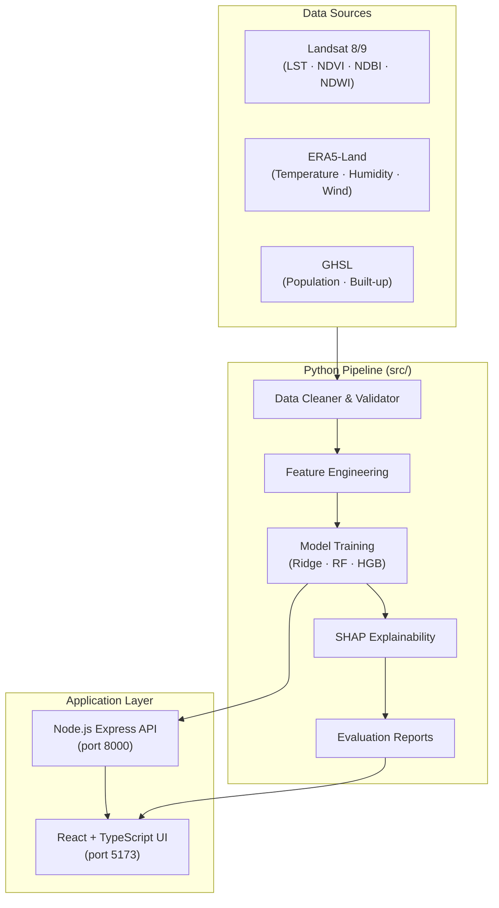

# Global Urban Heat Island (UHI) Analysis

> **42 cities · 10 years (2016–2025) · ~1 km grid · Machine Learning + Interactive Dashboard**

**Live demo: [https://urban-heat-island-analysis-temperat.vercel.app](https://urban-heat-island-analysis-temperat.vercel.app/)**

---

## Overview

The **Global Urban Heat Island (UHI) Analysis** project quantifies and predicts urban heat island dynamics across **42 cities** (24 Indian, 18 international) from January 2016 to December 2025. It integrates:

- **Landsat 8/9** satellite-derived LST, NDVI, NDBI, and NDWI at ~1 km spatial resolution.
- **ERA5-Land** climate reanalysis (temperature, humidity, wind, precipitation, solar radiation).
- **GHSL** population density and built-up fraction.
- Three ML regression models (Ridge, Random Forest, Hist Gradient Boosting) with SHAP explainability.
- An interactive **React + TypeScript** web dashboard and **Node.js** REST API.

---

## System Architecture



---

## Results Summary

| Model | Val 2024 RMSE | Val 2024 R² | Test 2025 RMSE | Test 2025 MAE | Test 2025 R² |
|---|---|---|---|---|---|
| Ridge Regression | 2.583 K | 0.159 | 1.577 K | 1.114 K | 0.369 |
| Random Forest | 2.387 K | 0.281 | 1.332 K | 0.785 K | 0.550 |
| **Hist Gradient Boosting** ⭐ | **2.370 K** | **0.291** | **1.279 K** | **0.774 K** | **0.585** |

> ⭐ Champion model — deployed via `models/champion_uhi_model.joblib`.

---

## Repository Structure

```
UHI_Project/
├── data/
│   ├── raw/              # Original satellite & ERA5 CSVs
│   ├── interim/          # Merged monthly & pixel-level datasets
│   └── processed/        # Final Parquet files used by API & models
├── models/               # Trained model artifacts (.joblib)
├── reports/              # JSON evaluation reports
├── src/
│   ├── data/             # Cleaner, loader, schema, validator
│   ├── features/         # EDA, engineering, rural baseline
│   ├── models/           # Regressors, forecaster, SHAP, simulator
│   └── pipeline.py       # Unified CLI pipeline driver
├── server/               # Node.js Express REST API
├── client/               # React + TypeScript + Vite + Tailwind UI
├── tests/                # Pytest (Python) + Jest/Vitest (TS) test suites
├── docs/
│   ├── data_dictionary.md
│   ├── model_cards.md
│   └── limitations.md
├── implementation.md
├── requirements.txt
└── README.md
```

---

## Quick Start

### Prerequisites
- Python ≥ 3.10
- Node.js ≥ 18

### 1 — Python setup
```powershell
python -m venv .venv
.\.venv\Scripts\activate
pip install -r requirements.txt
```

### 2 — Run the pipeline
```powershell
# Run all stages
python -m src.pipeline --stage all

# Or individual stages
python -m src.pipeline --stage clean
python -m src.pipeline --stage features
python -m src.pipeline --stage train
python -m src.pipeline --stage eval
```

### 3 — Start backend API
```powershell
cd server
npm install
npm run dev        # http://localhost:8000
```

### 4 — Start frontend
```powershell
cd client
npm install
npm run dev        # http://localhost:5173
```

### 5 — Run tests
```powershell
# Python tests
pytest -q

# Frontend tests
cd client && npm test
cd ../server && npm test
```

---

## Documentation

| Document | Description |
|---|---|
| [Data Dictionary](docs/data_dictionary.md) | All variables, units, satellite & reanalysis sources. |
| [Model Cards](docs/model_cards.md) | Model architectures, hyperparameters, training configuration, performance tables. |
| [Limitations](docs/limitations.md) | Cloud-gap handling, rural reference sensitivity, LST vs. air-temperature offsets, and more. |
| [Implementation Plan](implementation.md) | Full milestone checklist (Phases 1–5). |

---

## Citation

```
Kumar, A. et al. (2026). Global Urban Heat Island Analysis across 42 Cities (2016–2025).
GitHub: https://github.com/Atharv-2314/Urban-Heat-Island-Analysis-Temperature-Prediction
```
